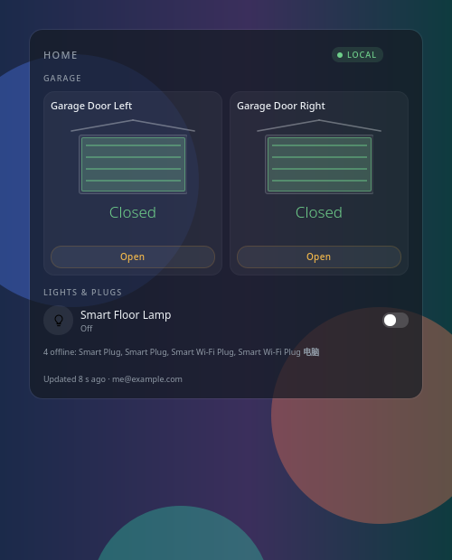
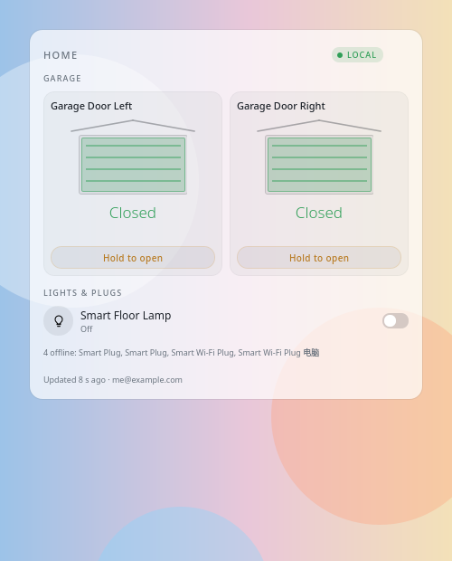
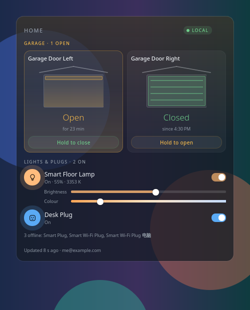
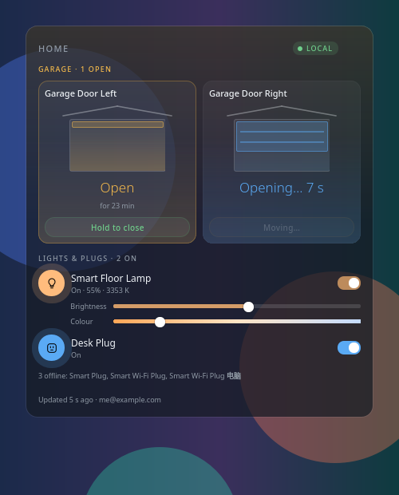

# Meross Deck

A Plasma 6 desktop widget for Meross garage door openers, lights and plugs. When the PC is on the same network it talks straight to the devices. Anywhere else it goes through the Meross cloud, the same way the Meross app does.

[](https://github.com/xiahongze/meross-deck/actions/workflows/ci.yml)   

| Dark | Light |
| --- | --- |
|  |  |

When a door is open the deck warms to amber. Lamps show brightness and colour while they're on:

| A door left open | A door on its way up |
| --- | --- |
|  |  |

## What it shows

- **Header.** A title (Home by default) and the link status:
  - `LOCAL` when every device answered on this network
  - `CLOUD` when they answered through Meross
  - `LIVE` when it's a mix
  - `RETRYING` or `OFFLINE` when they stop answering
  - `SIGN IN` when there's no session

  Hover over it for the detail.
- **Garage.** One card per door:
  - a drawn door that rises and falls with the state
  - the state and how long it has been that way (`for 23 min`, `since 4:30 PM`)
  - **Hold to open** / **Hold to close**: the button fills while you press, and the command goes only when it's full, so a stray click can't move a door
  - an obstruction warning when the opener reports one

  Meross openers report only open or closed, never "moving". After a command, or when a door is seen opening from the wall button or a remote, the card shows **Opening… 9 s** for the door's configured travel time and then re-reads. While any door is open, the deck takes on a soft amber wash.
- **Lights & plugs.** A switch for each channel:
  - Lamps that dim show brightness and colour-temperature sliders while they're on.
  - Drags are batched, so only the value you settle on is sent.
  - Offline devices collapse into one line at the bottom.
- **Footer.** How fresh the data is and which account it's using.

Changes show immediately and are confirmed by a re-read a moment later. If a command fails, the control goes back and the footer says why.

## Requirements

- Plasma 6, with its Plasma5Support executable engine (part of `plasma-workspace`)
- Python 3.11 or newer. The helper uses only the standard library.
- A Meross account with the devices already set up in the Meross app
- Konsole for the sign-in window. Without it, run the login command yourself.

## Install

```sh
./scripts/install.sh
```

Then:

1. Right-click the desktop, choose **Add Widgets…**, and add **Meross Deck**.
2. Click **Sign in…** in the widget. A terminal asks for your Meross email, your password and, if you use one, your authenticator code.

You can also sign in from a terminal:

```sh
python3 ~/.local/share/plasma/plasmoids/io.github.xiahongze.merossdeck/contents/code/meross_deck.py login
```

Add `--country US` (or `GB` and so on) if your account isn't Australian; the right region is found automatically either way.

If Plasma is already running an older copy, run `plasmashell --replace &` after upgrading so the new QML loads.

## Settings

- the Meross account: sign in, switch, sign out
- a title for the header
- connection: local network first with the cloud when away (default), local only, or cloud only
- refresh rate on the local network (10 s) and through the cloud (60 s)
- theme: System, Light or Dark
- background opacity (0 shows the widget straight on the wallpaper)
- which devices to show

## Privacy and credentials

- Your password is typed into a terminal, hashed (MD5, as the Meross app does) and sent once to Meross. It's never stored.
- What's kept is the session token, the account key and your user id, in `~/.config/meross-deck/session.json` with mode `0600`. Nothing sensitive goes into Plasma's settings or onto a command line.
- The widget connects with its own MQTT client id, so it doesn't knock the Meross app off the cloud.
- A device cache (names, local IPs, the last state) lives in `~/.cache/meross-deck/devices.json`.
- Every command the widget sends gets one line in `~/.cache/meross-deck/commands.log`. Each line has the time, the device, what was sent, the route, and the device's reply or the error. Run `tail -f ~/.cache/meross-deck/commands.log` to watch it.
- Nothing is sent anywhere except Meross's servers and your own devices.

## How it works

The Meross app isn't REST or gRPC. Accounts and the device list come from a signed, form-encoded HTTP API at `iotx-*.meross.com`. Devices are driven by a JSON message protocol:

- through the cloud it travels over MQTT (TLS, port 443)
- at home it is posted straight to `http://<device>/config`

Both use the same messages, signed with your account key.

[docs/API.md](docs/API.md) documents all three transports and the garage, light and plug commands, field by field. It was worked out from the decompiled Meross Android app (v3.42.3) and checked against live devices. Each claim is marked as verified, read from the code, or inferred.

The code:

- `src/meross_deck.py` is the helper. It holds:
  - cloud sign-in and the device list
  - a small MQTT 3.1.1 client
  - the LAN client
  - AES-256 for devices that encrypt LAN traffic

  The widget runs it once per refresh or command; it prints one JSON object and exits.
- `contents/ui/Client.qml` owns polling and commands. It keeps a pending overlay so a slow poll can't snap a control back, and times door travel.
- `contents/ui/DeckView.qml`, `DoorCard.qml` and `DeviceRow.qml` draw the deck.

Each refresh tries the local network first, with a 2.5 s timeout, and falls back to the cloud. After a miss it skips the local attempt for five minutes. Cloud readings are reused until they're older than the cloud refresh rate, so the cloud is read at most once a minute however fast the local rate is. Commands, and the re-read just after one, always go out at once. While signed out the widget stops polling.

## Supported devices

| | Tested | Expected to work |
| --- | --- | --- |
| Garage | MSG100 (reads; open and close are code-derived) | MSG150, MSG200 (doors 1–3) |
| Lights | MSL610 (on/off, brightness, colour temperature) | MSL1xx, MSL4xx, MDL110 (on/off and brightness) |
| Plugs | MSS210P (listed; offline during testing) | MSS1xx–3xx, MSS5xx–8xx switches, MSS425 strips |

## Develop and package

```sh
make test         # Python unit tests, then qmltestrunner offscreen against a fake helper
make lint         # compileall + qmllint
make package      # dist/meross-deck.plasmoid
make install      # package, then install or upgrade with kpackagetool6
make screenshots  # re-render docs/screenshots from the redacted fixture
```

`tests/fixtures/` holds real device replies with identifiers, MAC and IP addresses replaced.

The helper is handy on its own:

```sh
H=src/meross_deck.py
python3 $H devices                    # what's on the account
python3 $H state                      # every device, as the widget sees it
python3 $H probe <uuid> -n Appliance.System.All   # raw read-only GET
```

## Uninstall

```sh
kpackagetool6 --type Plasma/Applet --remove io.github.xiahongze.merossdeck
python3 src/meross_deck.py logout     # or delete ~/.config/meross-deck
```

## Credits

Not affiliated with Meross. Meross is a trademark of Chengdu Meross Technology Co., Ltd. Licensed under MIT.
